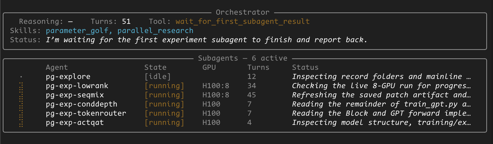

# Parallel Agents with OpenAI Agent SDK and Modal
This repo is an example of using OpenAI Agents SDK and Modal Sandboxes to implement a general purpose coding agent harness with async parallel workers. 

<p align="center">
  
</p>


### Example: Parameter Golf
While implemented to be general-purpose, the `/skills` markdown plugin system allows agents to opt-in to guides and context to improve their performance.

In this example we use OpenAI's [Parameter Golf](https://openai.com/index/parameter-golf/) challenge, with an associated skill, to allow the orchestrator agent to command a fleet of on-GPU workers to run parameter optimization experiments in parallel.

## Setup

### Installation
Use `uv` to install your dependencies (recommended):
```bash
uv sync
```

Or manage your own installations:
```bash
pip install openai-agents[modal] modal rich
```

This installs the [OpenAI Agents SDK](https://openai.github.io/openai-agents-python/agents/) with the Modal sandbox extension, as well as the [Modal SDK and CLI](https://modal.com/docs).

### Authentication
You will need to create an account with Modal, which includes $30 free credits to get started. To do so:
1. [Sign up to Modal](https://modal.com/signup)
2. Run `modal setup` in your terminal to authenticate. 

## Running

To run the example harness with a one-shot task:
```bash
uv run main.py --prompt "Start working on the parameter golf challenge. First pull the repo, explore past approaches, and create a working environment. Then create a plan for five parallel approaches that could be done, and guide those experiments through to completion, reporting their performance back."
```

This should trigger the loading of the [parameter_golf.md](skills/parameter_golf.md) skill, and kick off parallel experiments.

The harness can also be run as an interactive chat with:
```bash
uv run main.py --interactive
```

## Architecture

### Orchestrator Agent
The [orchestrator agent](/orchestrator.py) is the primary chat agent equipped with a `Session` memory, subagents-as-tools, a skills subsystem and Subagent pool subsystem. 

### Subagent Pool
The orchestrator owns [a pool of subagents](/subagent_pool.py), running as asyncio tasks to allow the orchestrator to delegate messages without blocking. The Pool enforces a strict GPU limit to ensure the orchestrator does not explode GPU budget on unproven tasks. Individual GPU type limits are configurable.

### Subagents
The [subagents](/subagent.py) are your "coding agents" with shell and file tools. They are implemented as tools to the orchestrator agent, allowing implementation details for each experiment to accumulate in the subagent and not bloat the orchestrator's context window. 

Each subagent has their own `Session` working memory and attached `ModalSandboxSession`. A subagent is a 1:1 map to a running sandbox.
<br>
<br>
# Reference Docs - Modal Extension


### ModalSandboxClient
BaseSandboxClient[ [ModalSandboxClientOptions](#modalsandboxclientoptions) ]

```python
from agents.extensions.sandbox.modal import ModalSandboxClient 
```

Top-level client. Creates, resumes, and deletes Modal-backed sandbox sessions.

- `create(options)` → [ModalSandboxSession](#modalsandboxsession) - spins up a new Modal sandbox and returns a live session.
- `resume(state)` → [ModalSandboxSession](#modalsandboxsession) - reconnects to an existing sandbox from a [ModalSandboxSessionState](#modalsandboxsessionstate).
- `delete(session)` - best-effort terminates the underlying Modal sandbox.
- `deserialize_session_state(payload)` → [ModalSandboxSessionState](#modalsandboxsessionstate)

---

### ModalSandboxClientOptions

```python
from agents.extensions.sandbox.modal import ModalSandboxClientOptions
```

Options passed to [ModalSandboxClient.create()](#modalsandboxclient).

| Field | Type | Default | Notes |
|---|---|---|---|
| `app_name` | `str` | - | Modal app to create sandboxes under |
| `workspace_persistence` | `"tar" \| "snapshot_filesystem"` | `"tar"` | How workspace state is saved/restored |
| `sandbox_create_timeout_s` | `float \| None` | `None` | Async timeout for sandbox creation |
| `snapshot_filesystem_timeout_s` | `float \| None` | `60.0` | Timeout for `snapshot_filesystem` call |
| `snapshot_filesystem_restore_timeout_s` | `float \| None` | `60.0` | Timeout for snapshot restore |
| `exposed_ports` | `tuple[int, ...]` | `()` | Ports to expose via Modal tunnels |
| `gpu` | `str \| None` | `None` | Modal GPU spec, e.g. `"A100"` or `"H100:8"` |
| `timeout` | `int` | `300` | Max sandbox lifetime in seconds |

---

### ModalSandboxSession
BaseSandboxSession

```python
from agents.extensions.sandbox.modal import ModalSandboxSession
```

A live session wrapping a running `modal.Sandbox`. Obtained from [ModalSandboxClient.create()](#modalsandboxclient) or [ModalSandboxClient.resume()](#modalsandboxclient).

- `state` → [ModalSandboxSessionState](#modalsandboxsessionstate)
- `exec(*command)` - runs a command and returns stdout/stderr/exit code.
- `read(path)` / `write(path, data)` - file I/O inside the sandbox.
- `running()` → `bool` - liveness check via `modal.Sandbox.poll()`.
- `persist_workspace()` / `hydrate_workspace(data)` - save/restore workspace using the mode set in [ModalSandboxClientOptions.workspace_persistence](#modalsandboxclientoptions).
- `snapshot_filesystem()` → `str` - calls Modal's `snapshot_filesystem` and returns the resulting image ID.
- `supports_pty()` → `True`
- `pty_exec_start(...)` / `pty_write_stdin(...)` / `pty_terminate_all()` - interactive PTY process management.

---

### ModalSandboxSessionState
SandboxSessionState

```python
from agents.extensions.sandbox.modal import ModalSandboxSessionState
```

Serializable state for a [ModalSandboxSession](#modalsandboxsession). Persisted to resume a session across process restarts.

| Field | Notes |
|---|---|
| `app_name` | Modal app name |
| `sandbox_id` | Live sandbox object ID (cleared on termination) |
| `image_id` | Modal image object ID |
| `image_tag` | Registry tag fallback (e.g. `"python:3.11-slim"`) |
| `workspace_persistence` | `"tar"` or `"snapshot_filesystem"` |
| `gpu` | GPU spec, mirrors [ModalSandboxClientOptions.gpu](#modalsandboxclientoptions) |
| `timeout` | Max sandbox lifetime in seconds |

---

### ModalImageSelector

```python
from agents.extensions.sandbox.modal import ModalImageSelector
```

Wraps the three ways to specify a Modal image. Obtained via class methods:

- `ModalImageSelector.from_image(image)` - in-memory `modal.Image` object.
- `ModalImageSelector.from_id(image_id)` - Modal image object ID string.
- `ModalImageSelector.from_tag(image_tag)` - registry tag, e.g. `"debian:bookworm"`.

Pass to [ModalSandboxClient](#modalsandboxclient) via `image=`.

---

### ModalSandboxSelector

```python
from agents.extensions.sandbox.modal import ModalSandboxSelector
```

Wraps the two ways to attach to an existing Modal sandbox. Obtained via class methods:

- `ModalSandboxSelector.from_sandbox(sandbox)` - in-memory `modal.Sandbox` object.
- `ModalSandboxSelector.from_id(sandbox_id)` - Modal sandbox object ID string.

Pass to [ModalSandboxClient](#modalsandboxclient) via `sandbox=`.

---

### ModalCloudBucketMountStrategy
MountStrategyBase

```python
from agents.extensions.sandbox.modal import ModalCloudBucketMountStrategy
```

Mount strategy that translates `S3Mount`, `R2Mount`, and `GCSMount` manifest entries into Modal-native `CloudBucketMount` volumes. Passed at mount definition time; Modal handles the actual mounting at sandbox creation.

---

### ModalCloudBucketMountConfig

```python
from agents.extensions.sandbox.modal import ModalCloudBucketMountConfig
```

Backend-neutral config produced by [ModalCloudBucketMountStrategy](#modalcloudbucketmountstrategy) from a mount entry.

| Field | Notes |
|---|---|
| `bucket_name` | Cloud bucket name |
| `bucket_endpoint_url` | S3-compatible endpoint URL (required for R2/GCS) |
| `key_prefix` | Optional key prefix within the bucket |
| `credentials` | Dict of credential env vars (e.g. `AWS_ACCESS_KEY_ID`) |
| `read_only` | Whether to mount read-only |
